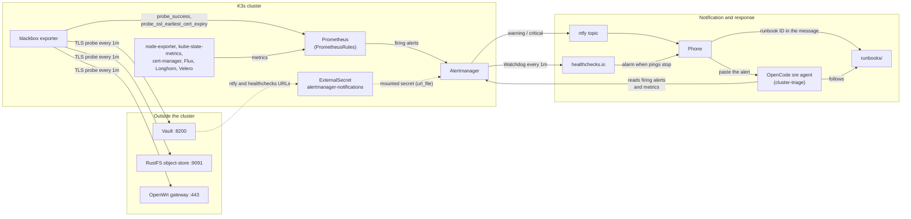
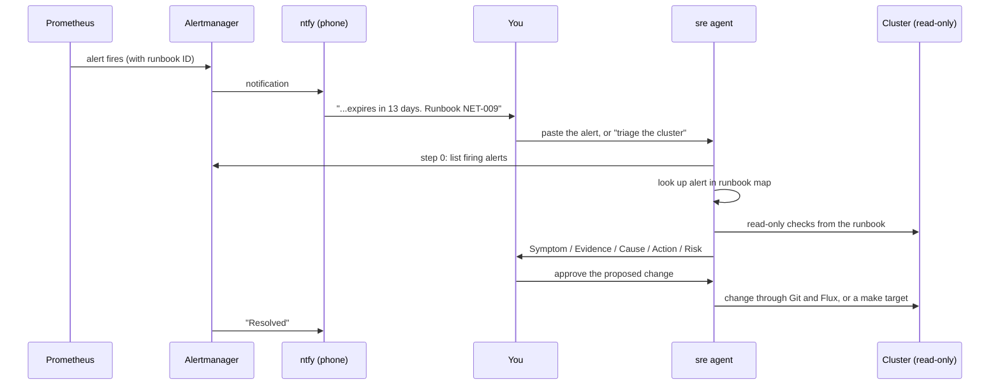

# Alerting

How alerts are built, delivered and handled in this homelab. This covers what was added on top of the upstream
[monitoring docs](../docs/_docs/monitoring.md). Fixes for specific alerts are in [runbooks/](../runbooks/README.md).

Contents:

- [Alerting overview](#alerting-overview)
- [Alert notifications (ntfy and healthchecks.io)](#alert-notifications-ntfy-and-healthchecksio)
- [Certificate expiry alerts](#certificate-expiry-alerts)
- [k3s upgrade alerts](#k3s-upgrade-alerts)
- [Node disk alerts](#node-disk-alerts)
- [Terraform (tofu-controller) alerts](#terraform-tofu-controller-alerts)
- [Backup, secrets, storage and scrape alerts](#backup-secrets-storage-and-scrape-alerts)
- [Raspberry Pi under-voltage alerts](#raspberry-pi-under-voltage-alerts)
- [Alerts and the sre agent](#alerts-and-the-sre-agent)
- [Mixin rule escaping](#mixin-rule-escaping)

## Alerting overview

How an alert gets from a metric to a person, and from there to a fix:



- **Rules** live next to what they watch: `k3s-mixins` (Kubernetes, nodes, Prometheus), `general` (Watchdog), `certificates-external` and `vault` (blackbox exporter), `cert-manager`, the Flux and Terraform rules in `flux-monitoring`, and per-service rules for External Secrets, Velero, Longhorn and Keycloak Postgres. See [Backup, secrets, storage and scrape alerts](#backup-secrets-storage-and-scrape-alerts).
- **Routing:** `severity=warning|critical` goes to ntfy, `Watchdog` goes to healthchecks.io as a dead-man's switch, `severity=info` is dropped. See [Alert notifications](#alert-notifications-ntfy-and-healthchecksio).
- **Runbooks:** every alert defined in this repository carries a runbook ID in its `runbook` annotation and at the end of its description, so it shows up in the ntfy message. The [OpenCode sre agent](#alerts-and-the-sre-agent) uses the same IDs.
- **The weak point is Vault:** the notification URLs come from Vault. If Vault is unreachable, already-running Alertmanager keeps working with the mounted secret, but a new deployment of the alerting config cannot sync it. healthchecks.io is the independent check that catches a silent Alertmanager.

## Alert notifications (ntfy and healthchecks.io)

By default the kube-prometheus-stack chart ships an Alertmanager configuration that routes every alert, including `Watchdog`, to a `null` receiver. Alerts show up in the Alertmanager UI, but nobody is notified.

The `alertmanager-notifications` component (prod overlay only) sends alerts to two places:

| Alerts | Receiver | Purpose |
|---|---|---|
| `severity=warning` and `severity=critical` | [ntfy](https://ntfy.sh) webhook | Push notification to the phone, plus a second one when the alert resolves |
| `Watchdog` | [healthchecks.io](https://healthchecks.io) webhook, every minute | Dead-man's switch. If the pings stop, healthchecks.io raises the alarm (Prometheus, Alertmanager or the network is down) |
| `severity=info` | `null` | Dropped |

A `critical` alert hides the `warning` alert with the same `alertname` and `namespace`.

### Files

```
kubernetes/platform/kube-prometheus-stack/
├── app/components/alertmanager-notifications/
│   ├── kustomization.yaml
│   ├── helm-patch.yaml                       # adds the values below to the HelmRelease valuesFrom
│   ├── values.yaml                           # alertmanager.config: routes and receivers
│   └── notifications-externalsecret.yaml     # Vault -> Secret alertmanager-notifications
└── k3s-mixins/base/rules/
    ├── general-rules.yaml                    # Watchdog alert
    └── kubeletdown-fix-patch.yaml            # KubeletDown expression fix (see below)
```

The component is listed in `app/overlays/prod/kustomization.yaml`. The `kube-prometheus-stack-app` Flux Kustomization depends on `external-secrets-config`, so the Secret exists before Alertmanager starts.

### Webhook URLs are secrets

Both URLs contain the secret part (the ntfy topic name and the healthchecks.io check UUID), so they are not stored in git. They live in Vault and reach Alertmanager like this:

1. Vault KV `secret/alertmanager/notifications`, keys `ntfy_url` and `healthchecks_url`.
2. `ExternalSecret` `alertmanager-notifications-externalsecret` creates Secret `alertmanager-notifications` in `kube-prom-stack`.
3. `alertmanager.alertmanagerSpec.secrets` mounts it at `/etc/alertmanager/secrets/alertmanager-notifications/`.
4. The receivers read the URLs with `webhook_configs[].url_file`.

> [!IMPORTANT]
> The Vault Terraform module only generates random passwords, so these URLs come from Ansible instead, like the IONOS and ThreatMap keys:
>
> 1. `make secret-files` asks for both URLs and saves them to `~/.secrets/alertmanager-notifications.ini` (mode 0600).
> 2. `make external-services` (Stage 5, `load_external_services_keys.yml`) writes them to Vault at `secret/alertmanager/notifications`.
>
> Keep a backup of `~/.secrets`: a rebuild reads the URLs from that file. To change a URL later, edit the file and run `make load-external-services-keys`, or write it to Vault directly:
>
> ```shell
> vault kv put secret/alertmanager/notifications \
>   ntfy_url='https://ntfy.sh/<topic>?template=alertmanager' \
>   healthchecks_url='https://hc-ping.com/<check-uuid>'
> ```


- **ntfy:** use a long random topic name. On ntfy.sh anyone who knows the name can read the topic. `?template=alertmanager` makes ntfy format the Alertmanager payload as a readable message.
- **healthchecks.io:** create a check with a 1 minute period and about 5 minutes grace time. Add a notification integration (for example ntfy on the same topic, or email), or nobody hears when the pings stop.

### Watchdog rule

The `k3s` component disables the chart's default rules (`defaultRules.create: false`) and the rules are generated from the mixins in `k3s-mixins/` instead. The mixins do not include `Watchdog`, so it is defined in `k3s-mixins/base/rules/general-rules.yaml`. It is always firing (`expr: vector(1)`) on purpose.

### KubeletDown fix

The kubernetes-mixin `KubeletDown` rule compares `kube_node_info` and `up{job="kubelet"}` grouped by the `cluster` label. In this cluster the `cluster` label is added by the Prometheus scrape class with `metricRelabelings`, and Prometheus does not apply those to the synthetic `up` series. The rule therefore never matched, and `KubeletDown` was always firing.

`kubeletdown-fix-patch.yaml` replaces the expression with:

```
absent(up{job="kubelet", metrics_path="/metrics"} == 1)
```

The patch starts with a JSON patch `test` op on the rule name. If regenerating the mixins (`make k3s-mixins`) moves the rule, the Kustomization fails to build instead of silently patching the wrong rule. Fix the index in the patch if that happens.

### Testing

Send a test alert through the whole chain. It should arrive on ntfy within about 30 seconds, followed by a "resolved" message about 5 minutes later:

```shell
kubectl -n kube-prom-stack exec alertmanager-kube-prometheus-stack-alertmanager-0 -c alertmanager -- \
  amtool alert add TestAlert severity=warning namespace=test --alertmanager.url=http://localhost:9093
```

The healthchecks.io check should show a ping every minute.

### Troubleshooting

```shell
# Secret synced from Vault
kubectl -n kube-prom-stack get externalsecret alertmanager-notifications-externalsecret
kubectl -n kube-prom-stack get secret alertmanager-notifications -o jsonpath='{.data}' | jq -c 'keys'

# Configuration Alertmanager actually runs (receivers and url_file paths)
kubectl -n kube-prom-stack get secret alertmanager-kube-prometheus-stack-alertmanager-generated \
  -o jsonpath='{.data.alertmanager\.yaml\.gz}' | base64 -d | gunzip

# Notification errors
kubectl -n kube-prom-stack logs alertmanager-kube-prometheus-stack-alertmanager-0 -c alertmanager --since=1h | grep -iE 'level=(error|warn)'

# Alerts currently firing and not silenced
kubectl get --raw "/api/v1/namespaces/kube-prom-stack/services/kube-prometheus-stack-alertmanager:http-web/proxy/api/v2/alerts?active=true&silenced=false&inhibited=false" \
  | jq -r '.[] | "\(.labels.severity) \(.labels.alertname) \(.labels.namespace // "-")"' | sort | uniq -c
```

To mute a noisy alert for a while, create a silence in the Alertmanager UI (`https://alertmanager.${CLUSTER_DOMAIN}`) rather than changing the routing.

## Certificate expiry alerts

Two kinds of TLS certificates are watched:

- **Outside the cluster** (Let's Encrypt, issued by Ansible with certbot, valid 90 days, not renewed automatically): Vault (`vault.${CLUSTER_DOMAIN}:8200`), RustFS (`object-store.${CLUSTER_DOMAIN}:9091`) and the OpenWrt gateway (`gateway.${CLUSTER_DOMAIN}:443`). A [blackbox exporter](https://github.com/prometheus/blackbox_exporter) (`kubernetes/platform/blackbox-exporter`) opens a TLS connection to each one every minute and reports the certificate's expiry date (`probe_ssl_earliest_cert_expiry`) and whether the endpoint answered (`probe_success`).
- **Inside the cluster** (cert-manager): cert-manager's own metrics.

| Alert | Fires when | Severity |
|---|---|---|
| `TLSCertificateExpiringSoon` | an external certificate has less than 14 days left | warning |
| `TLSCertificateExpiringCritical` | less than 3 days left | critical |
| `TLSCertificateExpired` | the certificate has expired | critical |
| `ExternalEndpointDown` | the endpoint has not completed a TLS handshake for 5 minutes | critical |
| `CertManagerCertificateNotReady` | a cert-manager certificate has not been ready for 15 minutes | warning |
| `CertManagerCertificateRenewalOverdue` | cert-manager is more than 1 hour past the certificate's renewal time | warning |
| `CertManagerCertificateExpiringCritical` | a cert-manager certificate expires in less than 24 hours | critical |

The cert-manager alerts use the renewal time instead of a fixed number of days because certificate lifetimes differ (the envoy-gateway certificate lasts about 7 days).

The blackbox `tls_connect` module skips certificate verification on purpose, so the expiry date is still reported after a certificate has expired. Without it, an expired certificate would only show up as `ExternalEndpointDown`.

To renew an external certificate, run the matching target from the repository root on the Ansible control node:

| Endpoint | Command |
|---|---|
| Vault | `make deploy-vault` (restarts Vault; the role unseals it again) |
| RustFS | `make deploy-rustfs` |
| OpenWrt gateway | `make openwrt-certbot-tls` |

Days left for each external certificate (Prometheus):

```
(probe_ssl_earliest_cert_expiry - time()) / 86400
```

Files:

```
kubernetes/platform/blackbox-exporter/app/base/
├── helm.yaml                    # OCIRepository + HelmRelease (prometheus-blackbox-exporter)
├── values.yaml                  # tls_connect module, one ServiceMonitor per target
└── certificate-rules.yaml       # TLSCertificate* and ExternalEndpointDown alerts
kubernetes/platform/blackbox-exporter/app/overlays/prod/values.yaml   # targets
kubernetes/platform/cert-manager/app/components/monitoring/cert-manager-rules.yaml
```

## k3s upgrade alerts

k3s is upgraded by [system-upgrade-controller](https://github.com/rancher/system-upgrade-controller) from two Plans (`k3s-server`, then `k3s-agent`). The controller never retries a failed upgrade job, so a single failure leaves the remaining nodes on the old version without any error elsewhere.

kube-state-metrics exports each Plan as `suc_plan_info{name, target_version, complete}` (`customResourceState` in `kube-prometheus-stack/app/components/flux-monitoring/values.yaml`).

| Alert | Fires when | Severity |
|---|---|---|
| `K3sUpgradePlanStuck` | a Plan has not been Complete for 2 hours | warning |
| `K3sNodeVersionDrift` | a node has run a k3s version that matches no Plan for 2 hours | warning |

A full rolling upgrade takes about an hour, so neither fires during a normal upgrade. `KubeVersionMismatch` (from the kubernetes mixin) does fire during every upgrade and clears when it finishes. All three point to runbook [CLUSTER-015](../runbooks/cluster/nodes-capacity.md#runbook-cluster-015).

The `k3s-agent` Plan has `jobActiveDeadlineSecs: 7200`. Its jobs are created together with the master jobs and first wait until every master runs the new version; that wait counts against the deadline, and 30 minutes was not enough.

Files:

```
kubernetes/platform/system-upgrade/config/base/k3s-upgrade-rules.yaml
kubernetes/platform/kube-prometheus-stack/app/components/flux-monitoring/values.yaml   # suc_plan_info
```

## Node disk alerts

The kubelet evicts pods once a node's root disk is 85% full (DiskPressure). The mixin filesystem alerts only fire at 5% and 3% free, and the mixin `KubeNodePressure` alert is severity `info`, which is not routed. On 2026-11-07 node-esp-2 reached DiskPressure and evicted fluent-bit without any notification.

| Alert | Fires when | Severity |
|---|---|---|
| `NodeRootDiskFillingUp` | a node's root filesystem is over 80% full for 15 minutes | warning |
| `KubeNodeDiskPressure` | a node has had the DiskPressure condition for 5 minutes | critical |

Both point to runbook [CLUSTER-012](../runbooks/cluster/nodes-capacity.md#runbook-cluster-012).

Two node settings keep the disks from filling up in the first place:

- **Image GC:** `imageGCHighThresholdPercent: 70` / `imageGCLowThresholdPercent: 60` in `k3s_kubelet_config` (`ansible/vars/picluster.yml`). The default of 85% started image cleanup at the same point as eviction.
- **Journal size:** `SystemMaxUse=500M` (`ansible/roles/basic_setup/tasks/journald.yml`, variable `journald_system_max_use`).

Both are set on new installs. On running nodes, `make node-config-update` applies them: it restarts k3s only on nodes whose kubelet config changed, one node at a time, and waits for each node to be Ready.

Files:

```
kubernetes/platform/kube-prometheus-stack/k3s-mixins/base/rules/node-disk-rules.yaml
ansible/vars/picluster.yml                          # k3s_kubelet_config
ansible/roles/basic_setup/tasks/journald.yml
ansible/update_node_config.yml                      # make node-config-update
```

## Terraform (tofu-controller) alerts

The `config-elastic` and `config-keycloak` Terraform resources are applied by tofu-controller. When a `tf-runner` pod dies during a plan, the OpenTofu state lock stays behind and every later run fails on it. In November 2026 this went unnoticed for four days (6577 failed runs).

kube-state-metrics exports each resource (`customResourceState` in `kube-prometheus-stack/app/components/flux-monitoring/values.yaml`):

- `tofu_terraform_info{name, ready, reason, state_locked, lock_id, suspended}`
- `tofu_terraform_reconciliation_failures{name}`: failed runs since the last success

| Alert | Fires when | Severity |
|---|---|---|
| `TerraformStateLocked` | a resource has had a stuck state lock for 15 minutes; the message includes the lock ID and the failure count | warning |
| `TerraformNotReady` | a resource (not suspended) has not been Ready for 1 hour | warning |

Both point to runbook [GITOPS-007](../runbooks/cluster/gitops-release.md#runbook-gitops-007), which force-unlocks with the lock ID from the alert.

Files:

```
kubernetes/platform/kube-prometheus-stack/app/components/flux-monitoring/tofu-alert-rules.yaml
kubernetes/platform/kube-prometheus-stack/app/components/flux-monitoring/values.yaml   # tofu_terraform_*
```

## Backup, secrets, storage and scrape alerts

Added 2026-11-08. Before this, nothing alerted on a sealed Vault, broken secret syncing, failed backups, a degraded Longhorn volume, or a dead exporter. While building them, the Longhorn metrics turned out to have been missing for weeks: the Longhorn 1.12 chart creates its own NetworkPolicy, which dropped Prometheus. `prometheus-networkpolicy.yaml` in the Longhorn monitor component now allows it.

| Alert | Fires when | Severity | Runbook |
|---|---|---|---|
| `VaultSealed` | Vault answers TLS but `/v1/sys/health` is not 200 (503 sealed) for 5 minutes | critical | [VAULT-001](../runbooks/components/vault.md#runbook-vault-001) |
| `ClusterSecretStoreNotReady` | store `vault-backend` cannot reach or log in to Vault for 10 minutes | critical | [VAULT-006](../runbooks/components/vault.md#runbook-vault-006) |
| `ExternalSecretNotReady` | one ExternalSecret has failed to sync for 30 minutes | warning | [VAULT-006](../runbooks/components/vault.md#runbook-vault-006) |
| `VeleroBackupFailed` | a scheduled backup failed or partially failed (fires for 24 hours) | warning | [BACKUP-004](../runbooks/cluster/backup-compliance.md#runbook-backup-004) |
| `VeleroNoRecentBackup` | no successful scheduled backup in 25 hours | critical | [BACKUP-004](../runbooks/cluster/backup-compliance.md#runbook-backup-004) |
| `LonghornVolumeDegraded` | a volume has missing replicas for 30 minutes | warning | [LONGHORN-001](../runbooks/components/longhorn.md#runbook-longhorn-001) |
| `LonghornVolumeFaulted` | a volume has no healthy replica for 5 minutes | critical | [LONGHORN-001](../runbooks/components/longhorn.md#runbook-longhorn-001) |
| `CNPGWALArchivingFailing` | Keycloak Postgres cannot archive WAL to RustFS for 15 minutes | critical | [PG-001](../runbooks/components/data-services.md#runbook-pg-001) |
| `CNPGNoRecentBackup` | no Keycloak Postgres base backup in 26 hours | warning | [PG-001](../runbooks/components/data-services.md#runbook-pg-001) |
| `ScrapeTargetDown` | any scrape target down for 15 minutes (e-commerce excluded); covers node1 node-exporter and bind | warning | [OBS-001](../runbooks/components/observability.md#runbook-obs-001) |

The Vault seal check is a second blackbox probe (target `vault-health`, module `vault_health`, an HTTP GET that only accepts 200). It is excluded from the certificate alerts and `ExternalEndpointDown`, which keep using the TLS probe (target `vault`).

Files:

```
kubernetes/platform/blackbox-exporter/app/base/vault-rules.yaml                 # VaultSealed (+ module in values.yaml, target in overlays/prod)
kubernetes/platform/external-secrets/app/overlays/prod/eso-alert-rules.yaml
kubernetes/platform/velero/app/components/monitoring/velero-alert-rules.yaml
kubernetes/platform/longhorn/app/components/monitor/longhorn-alert-rules.yaml
kubernetes/platform/longhorn/app/components/monitor/prometheus-networkpolicy.yaml
kubernetes/platform/keycloak/database/overlays/prod/postgres-alert-rules.yaml
kubernetes/platform/kube-prometheus-stack/k3s-mixins/base/rules/scrape-target-rules.yaml
```

## Raspberry Pi under-voltage alerts

On 2026-11-05 a loose power cable made node6's firmware run the CPU at 600MHz for days. Linux kept reporting 1.8GHz (`scaling_cur_freq`), so no existing metric showed it. Only `vcgencmd get_throttled` does ([postmortem](../postmortems/incident-2026-11-05-node6-undervoltage.md)).

How the value reaches Prometheus:

- Ansible installs `/usr/local/bin/rpi_throttled_metrics` and the systemd timer `rpi-throttled-metrics` on every Pi (`raspberrypi` group, node1–6). Every minute it writes `/var/lib/node_exporter/rpi_throttled.prom`.
- node-exporter reads that directory with its textfile collector: the host `node_exporter` on node1 (role default), the DaemonSet on the k3s nodes (hostPath mount and `--collector.textfile.directory` in `kube-prometheus-stack/app/base/values.yaml`).
- Metrics: `rpi_undervoltage_events_recent` (kernel `Undervoltage detected!` messages in the last 2 minutes: catches dips shorter than the 1-minute snapshot), `rpi_throttled_flag{flag}` (`under_voltage_now`, `capped_now`, `throttled_now`, `soft_temp_limit_now` and the same `*_since_boot`), `rpi_throttled_raw`, `rpi_cpu_clock_hz` (real clock from the firmware).

Install or update it on existing nodes with `make node-config-update` (it does not restart k3s unless the kubelet config changed).

| Alert | Fires when | Severity |
|---|---|---|
| `RaspberryPiUnderVoltage` | any under-voltage dip in the last 10 minutes, from the kernel log or the firmware flag; shows the number of dips | warning |
| `RaspberryPiThrottled` | CPU throttled or capped for 5 minutes; the message shows the real clock | critical |
| `RaspberryPiThrottleMetricsMissing` | a Pi's file is older than 10 minutes, or an arm64 node has none | warning |

All point to runbook [CLUSTER-016](../runbooks/cluster/nodes-capacity.md#runbook-cluster-016). The `*_since_boot` flags are not alerted on: they stay set until the next reboot.

Files:

```
ansible/roles/basic_setup/scripts/rpi_throttled_metrics
ansible/roles/basic_setup/tasks/rpi_throttle_metrics.yml
kubernetes/platform/kube-prometheus-stack/app/base/values.yaml                     # textfile collector
kubernetes/platform/kube-prometheus-stack/k3s-mixins/base/rules/rpi-throttle-rules.yaml
```

## Alerts and the sre agent

<a id="alerts-and-the-sre-agent"></a>
Alerts reach a phone through ntfy (see [Alerting overview](#alerting-overview)). The agent is not started automatically by an alert: a person reads the alert and decides whether to hand it to the agent. That keeps a human in the loop for anything the agent would run against the live cluster.



How the pieces connect:

| Piece | Where | What it gives the agent |
| --- | --- | --- |
| `runbook` annotation on each alert | PrometheusRules in `kubernetes/` | The runbook ID, also shown at the end of the ntfy message |
| Step 0 of `cluster-triage` | `.opencode/skills/cluster-triage/SKILL.md` | Starts every triage from the firing alerts instead of a blind sweep |
| Alert → runbook table | `.opencode/skills/cluster-triage/references/runbook-map.md` | Maps alert names, including chart and mixin alerts without an annotation, to runbook IDs |
| Step 10 of `cluster-triage` | same skill | Certificate days left and reachability for Vault, RustFS and the gateway from the blackbox exporter |

When adding an alert, give it a `runbook` annotation and end its description with `Runbook <ID>.` (no colon: an unquoted `: ` breaks the YAML). If no runbook fits yet, add a row to the alert table with the first check to run, and add the runbook ID to the backlog in `runbooks/README.md`.

## Mixin rule escaping

The upstream `generate.sh` in `kubernetes/platform/kube-prometheus-stack/k3s-mixins/build/src/` escaped rule
templates for Helm (`` {{`{{`}} ``). That is only correct when the rules are rendered by Helm. Here the
generated rules are applied by Flux/Kustomize, so the escaping reached Alertmanager as literal text and alert
messages showed `{{ $labels.pod }}` instead of the real values. The escaping step was removed (2026-11) and
the generated rules in `k3s-mixins/base/rules/` contain plain `{{ $labels.x }}` templates.
