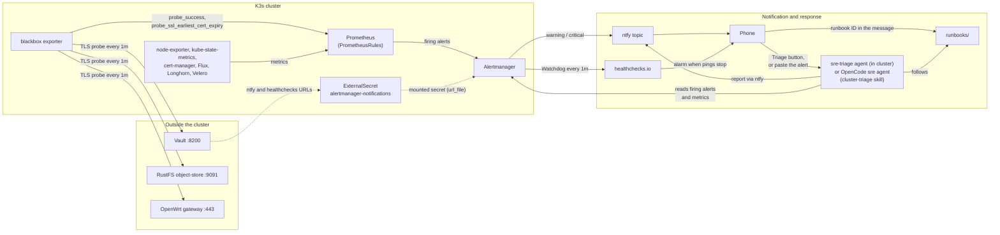
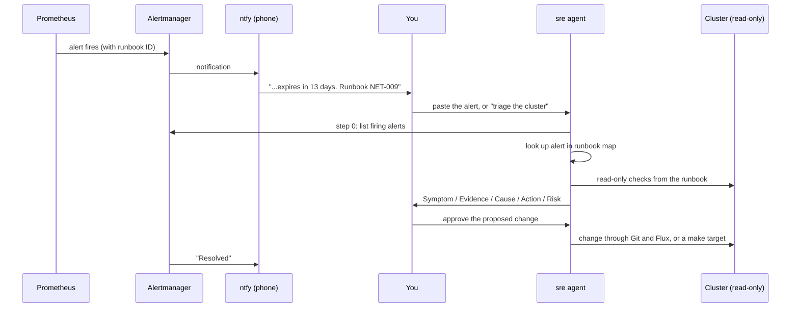

# Alerting

How alerts are built, delivered and handled in this homelab. This covers what was added on top of the upstream
[monitoring docs](../docs/_docs/monitoring.md). Fixes for specific alerts are in [runbooks/](../runbooks/README.md).

Contents:

- [Alerting overview](#alerting-overview)
- [Alert notifications (ntfy and healthchecks.io)](#alert-notifications-ntfy-and-healthchecksio)
- [Certificate expiry alerts](#certificate-expiry-alerts)
- [k3s upgrade alerts](#k3s-upgrade-alerts)
- [Node disk alerts](#node-disk-alerts)
- [Terraform (tofu-controller) alerts](#terraform-tofu-controller-alerts)
- [Backup, secrets, storage and scrape alerts](#backup-secrets-storage-and-scrape-alerts)
- [Raspberry Pi under-voltage alerts](#raspberry-pi-under-voltage-alerts)
- [Disk health (SMART) alerts](#disk-health-smart-alerts)
- [Alerts and the sre agent](#alerts-and-the-sre-agent)
- [Mixin rule escaping](#mixin-rule-escaping)

## Alerting overview

How an alert gets from a metric to a person, and from there to a fix:



- **Rules** live next to what they watch: `k3s-mixins` (Kubernetes, nodes, Prometheus), `general` (Watchdog), `certificates-external` and `vault` (blackbox exporter), `cert-manager`, the Flux and Terraform rules in `flux-monitoring`, and per-service rules for External Secrets, Velero, Longhorn and Keycloak Postgres. See [Backup, secrets, storage and scrape alerts](#backup-secrets-storage-and-scrape-alerts).
- **Routing:** `severity=warning|critical` goes to ntfy, `Watchdog` goes to healthchecks.io as a dead-man's switch, `severity=info` is dropped. See [Alert notifications](#alert-notifications-ntfy-and-healthchecksio).
- **Runbooks:** every alert defined in this repository carries a runbook ID in its `runbook` annotation and at the end of its description, so it shows up in the ntfy message. The [triage agents](#alerts-and-the-sre-agent) use the same IDs.
- **The weak point is Vault:** the notification URLs come from Vault. If Vault is unreachable, already-running Alertmanager keeps working with the mounted secret, but a new deployment of the alerting config cannot sync it. healthchecks.io is the independent check that catches a silent Alertmanager.

## Alert notifications (ntfy and healthchecks.io)

By default the kube-prometheus-stack chart ships an Alertmanager configuration that routes every alert, including `Watchdog`, to a `null` receiver. Alerts show up in the Alertmanager UI, but nobody is notified.

The `alertmanager-notifications` component (prod overlay only) sends alerts to two places:

| Alerts | Receiver | Purpose |
|---|---|---|
| `severity=warning` and `severity=critical` | [ntfy](https://ntfy.sh) webhook | Push notification to the phone, plus a second one when the alert resolves |
| `Watchdog` | [healthchecks.io](https://healthchecks.io) webhook, every minute | Dead-man's switch. If the pings stop, healthchecks.io raises the alarm (Prometheus, Alertmanager or the network is down) |
| `severity=info` | `null` | Dropped |

A `critical` alert hides the `warning` alert with the same `alertname` and `namespace`.

### Files

```
kubernetes/platform/kube-prometheus-stack/
├── app/components/alertmanager-notifications/
│   ├── kustomization.yaml
│   ├── helm-patch.yaml                       # adds the values below to the HelmRelease valuesFrom
│   ├── values.yaml                           # alertmanager.config: routes and receivers
│   └── notifications-externalsecret.yaml     # Vault -> Secret alertmanager-notifications
└── k3s-mixins/base/rules/
    ├── general-rules.yaml                    # Watchdog alert
    └── kubeletdown-fix-patch.yaml            # KubeletDown expression fix (see below)
```

The component is listed in `app/overlays/prod/kustomization.yaml`. The `kube-prometheus-stack-app` Flux Kustomization depends on `external-secrets-config`, so the Secret exists before Alertmanager starts.

### Webhook URLs are secrets

Both URLs contain the secret part (the ntfy topic name and the healthchecks.io check UUID), so they are not stored in git. They live in Vault and reach Alertmanager like this:

1. Vault KV `secret/alertmanager/notifications`, keys `ntfy_url` and `healthchecks_url`.
2. `ExternalSecret` `alertmanager-notifications-externalsecret` creates Secret `alertmanager-notifications` in `kube-prom-stack`.
3. `alertmanager.alertmanagerSpec.secrets` mounts it at `/etc/alertmanager/secrets/alertmanager-notifications/`.
4. The receivers read the URLs with `webhook_configs[].url_file`.

> [!IMPORTANT]
> The Vault Terraform module only generates random passwords, so these URLs come from Ansible instead, like the IONOS and ThreatMap keys:
>
> 1. `make secret-files` asks for both URLs and saves them to `~/.secrets/alertmanager-notifications.ini` (mode 0600).
> 2. `make external-services` (Stage 5, `load_external_services_keys.yml`) writes them to Vault at `secret/alertmanager/notifications`.
>
> Keep a backup of `~/.secrets`: a rebuild reads the URLs from that file. Keep `ntfy_url` there without the
> Triage button: Stage 5 appends it from `~/.secrets/sre-triage.ini` ([sre-triage-agent.md](sre-triage-agent.md#68-the-triage-button-in-ntfy) 6.8),
> and replaces `?template=alertmanager` with the compact template (see "Message size" below), so a direct
> `vault kv put` with the plain URL below removes both until the next run. To change a URL later, edit the file and run `make load-external-services-keys`, or write it to Vault directly:
>
> ```shell
> vault kv put secret/alertmanager/notifications \
>   ntfy_url='https://ntfy.sh/<topic>?template=alertmanager' \
>   healthchecks_url='https://hc-ping.com/<check-uuid>'
> ```


- **ntfy:** use a long random topic name. On ntfy.sh anyone who knows the name can read the topic. `?template=alertmanager` makes ntfy format the Alertmanager payload as a readable message; Stage 5 swaps it for the compact template below.
- **healthchecks.io:** create a check with a 1 minute period and about 5 minutes grace time. Add a notification integration (for example ntfy on the same topic, or email), or nobody hears when the pings stop.

### Message size

ntfy limits a message to 4096 bytes, and Android push (Firebase) cuts the whole notification JSON at
4000 bytes: the app then shows the cut text unless the subscription uses instant delivery. Two problems
came from that (fixed 2026-11-19):

- **Lost alerts.** ntfy's built-in `?template=alertmanager` prints receiver, start time and the long
  Prometheus source URL for every alert. A group of 4 or more alerts went over 4096 bytes after
  templating; ntfy answered HTTP 400 ("message or title is too large after replacing template") and
  Alertmanager does not retry a 4xx, so the notification was dropped. Tested on ntfy.sh: 1 alert
  1046 bytes, 3 alerts 3084, 4 alerts HTTP 400.
- **Cut text.** Groups of 2–3 alerts landed near 4000 bytes and arrived cut on the phone.

Fix:

- `max_alerts: 5` on the ntfy webhook (`components/alertmanager-notifications/values.yaml`). Alertmanager
  sends the number of left-out alerts as `truncatedAlerts`.
- Stage 5 (`ansible/tasks/load_alertmanager_notifications_into_vault.yml`) replaces
  `template=alertmanager` in `ntfy_url` with an inline ntfy template (`tpl=yes&t=…&m=…`). Per alert:
  summary, namespace/node/pod/instance, the description cut to 300 characters and the runbook ID. The
  title shows severity and count, for example `🚨 KubePodCrashLooping [warning] (5+7)`, and the message
  ends with "+7 more not listed". 5 alerts with long descriptions come to about 2 KB.

To change the template, edit that task and run `make load-external-services-keys`.

To check whether notifications were lost, look for failed webhook calls on node2:

```shell
kubectl -n kube-prom-stack logs alertmanager-kube-prometheus-stack-0 -c alertmanager | grep -iE 'notify.*(fail|error)|40041' | tail -5
```

On iOS the lock-screen notification shows only the first 100 characters (ntfy's APNs limit); open the
app for the full text. On Android, enable **instant delivery** on the alerts topic so a message cut by
Firebase is replaced by the full one.

### Watchdog rule

The `k3s` component disables the chart's default rules (`defaultRules.create: false`) and the rules are generated from the mixins in `k3s-mixins/` instead. The mixins do not include `Watchdog`, so it is defined in `k3s-mixins/base/rules/general-rules.yaml`. It is always firing (`expr: vector(1)`) on purpose.

### KubeletDown fix

The kubernetes-mixin `KubeletDown` rule compares `kube_node_info` and `up{job="kubelet"}` grouped by the `cluster` label. In this cluster the `cluster` label is added by the Prometheus scrape class with `metricRelabelings`, and Prometheus does not apply those to the synthetic `up` series. The rule therefore never matched, and `KubeletDown` was always firing.

`kubeletdown-fix-patch.yaml` replaces the expression with:

```
absent(up{job="kubelet", metrics_path="/metrics"} == 1)
```

The patch starts with a JSON patch `test` op on the rule name. If regenerating the mixins (`make k3s-mixins`) moves the rule, the Kustomization fails to build instead of silently patching the wrong rule. Fix the index in the patch if that happens.

### Testing

Send a test alert through the whole chain. It should arrive on ntfy within about 30 seconds, followed by a "resolved" message about 5 minutes later:

```shell
kubectl -n kube-prom-stack exec alertmanager-kube-prometheus-stack-0 -c alertmanager -- \
  amtool alert add TestAlert severity=warning namespace=test --alertmanager.url=http://localhost:9093
```

The healthchecks.io check should show a ping every minute.

### Troubleshooting

```shell
# Secret synced from Vault
kubectl -n kube-prom-stack get externalsecret alertmanager-notifications-externalsecret
kubectl -n kube-prom-stack get secret alertmanager-notifications -o jsonpath='{.data}' | jq -c 'keys'

# Configuration Alertmanager actually runs (receivers and url_file paths)
kubectl -n kube-prom-stack get secret alertmanager-kube-prometheus-stack-alertmanager-generated \
  -o jsonpath='{.data.alertmanager\.yaml\.gz}' | base64 -d | gunzip

# Notification errors
kubectl -n kube-prom-stack logs alertmanager-kube-prometheus-stack-0 -c alertmanager --since=1h | grep -iE 'level=(error|warn)'

# Alerts currently firing and not silenced
kubectl get --raw "/api/v1/namespaces/kube-prom-stack/services/kube-prometheus-stack-alertmanager:http-web/proxy/api/v2/alerts?active=true&silenced=false&inhibited=false" \
  | jq -r '.[] | "\(.labels.severity) \(.labels.alertname) \(.labels.namespace // "-")"' | sort | uniq -c
```

To mute a noisy alert for a while, create a silence in the Alertmanager UI (`https://alertmanager.${CLUSTER_DOMAIN}`) rather than changing the routing.

## Certificate expiry alerts

Two kinds of TLS certificates are watched:

- **Outside the cluster** (Let's Encrypt, issued by Ansible with certbot, valid 90 days, not renewed automatically): Vault (`vault.${CLUSTER_DOMAIN}:8200`), RustFS (`object-store.${CLUSTER_DOMAIN}:9091`) and the OpenWrt gateway (`gateway.${CLUSTER_DOMAIN}:443`). A [blackbox exporter](https://github.com/prometheus/blackbox_exporter) (`kubernetes/platform/blackbox-exporter`) opens a TLS connection to each one every minute and reports the certificate's expiry date (`probe_ssl_earliest_cert_expiry`) and whether the endpoint answered (`probe_success`).
- **Inside the cluster** (cert-manager): cert-manager's own metrics. They see the certificate Secret, not what is served. So the `TLSCertificate*` alerts also cover one web probe, `web-grafana`, which reports the certificate the Envoy gateway actually sends to browsers. Every web UI uses the same wildcard certificate (`pi-cluster-tls`), so one probe is enough. If `web-grafana` fires while `pi-cluster-tls` shows a renewed certificate, Envoy is serving an old one: runbook `NET-007`.

| Alert | Fires when | Severity |
|---|---|---|
| `TLSCertificateExpiringSoon` | an external certificate, or the one the gateway serves (`web-grafana`), has less than 14 days left | warning |
| `TLSCertificateExpiringCritical` | less than 3 days left | critical |
| `TLSCertificateExpired` | the certificate has expired | critical |
| `ExternalEndpointDown` | the endpoint has not completed a TLS handshake for 5 minutes | critical |
| `CertManagerCertificateNotReady` | a cert-manager certificate has not been ready for 15 minutes | warning |
| `CertManagerCertificateRenewalOverdue` | cert-manager is more than 1 hour past the certificate's renewal time | warning |
| `CertManagerCertificateExpiringCritical` | a cert-manager certificate expires in less than 24 hours | critical |

The cert-manager alerts use the renewal time instead of a fixed number of days because certificate lifetimes differ (Let's Encrypt certificates such as `pi-cluster-tls` last 90 days and are renewed with about 30 days left; the internal CA and webhook certificates last much longer).

The blackbox `tls_connect` module skips certificate verification on purpose, so the expiry date is still reported after a certificate has expired. Without it, an expired certificate would only show up as `ExternalEndpointDown`.

To renew an external certificate, run the matching target from the repository root on the Ansible control node:

| Endpoint | Command |
|---|---|
| Vault | `make deploy-vault` (restarts Vault; the role unseals it again) |
| RustFS | `make deploy-rustfs` |
| OpenWrt gateway | `make openwrt-certbot-tls` |

Days left for each external certificate (Prometheus):

```
(probe_ssl_earliest_cert_expiry - time()) / 86400
```

Files:

```
kubernetes/platform/blackbox-exporter/app/base/
├── helm.yaml                    # OCIRepository + HelmRelease (prometheus-blackbox-exporter)
├── values.yaml                  # tls_connect module, one ServiceMonitor per target
└── certificate-rules.yaml       # TLSCertificate* and ExternalEndpointDown alerts
kubernetes/platform/blackbox-exporter/app/overlays/prod/values.yaml   # targets
kubernetes/platform/cert-manager/app/components/monitoring/cert-manager-rules.yaml
```

## k3s upgrade alerts

k3s is upgraded by [system-upgrade-controller](https://github.com/rancher/system-upgrade-controller) from two Plans (`k3s-server`, then `k3s-agent`). The controller never retries a failed upgrade job, so a single failure leaves the remaining nodes on the old version without any error elsewhere.

kube-state-metrics exports each Plan as `suc_plan_info{name, target_version, complete}` (`customResourceState` in `kube-prometheus-stack/app/components/flux-monitoring/values.yaml`).

| Alert | Fires when | Severity |
|---|---|---|
| `K3sUpgradePlanStuck` | a Plan has not been Complete for 2 hours | warning |
| `K3sNodeVersionDrift` | a node has run a k3s version that matches no Plan for 2 hours | warning |

A full rolling upgrade takes about an hour, so neither fires during a normal upgrade. `KubeVersionMismatch` (from the kubernetes mixin) does fire during every upgrade and clears when it finishes. All three point to runbook [CLUSTER-015](../runbooks/cluster/nodes-capacity.md#runbook-cluster-015).

The `k3s-agent` Plan has `jobActiveDeadlineSecs: 7200`. Its jobs are created together with the master jobs and first wait until every master runs the new version; that wait counts against the deadline, and 30 minutes was not enough.

Files:

```
kubernetes/platform/system-upgrade/config/base/k3s-upgrade-rules.yaml
kubernetes/platform/kube-prometheus-stack/app/components/flux-monitoring/values.yaml   # suc_plan_info
```

## Node disk alerts

The kubelet evicts pods once a node's root disk is 95% full (DiskPressure; k3s sets `imagefs.available<5%` and `nodefs.available<5%`, checked with `configz` on 2026-11-15). Image pulls can add several GB at once, so the warning fires at 80%. The mixin filesystem alerts only fire at 5% and 3% free, and the mixin `KubeNodePressure` alert is severity `info`, which is not routed. On 2026-11-07 node-esp-2 reached DiskPressure and evicted fluent-bit without any notification.

| Alert | Fires when | Severity |
|---|---|---|
| `NodeRootDiskFillingUp` | a node's root filesystem is over 80% full for 15 minutes | warning |
| `KubeNodeDiskPressure` | a node has had the DiskPressure condition for 5 minutes | critical |

Both point to runbook [CLUSTER-012](../runbooks/cluster/nodes-capacity.md#runbook-cluster-012).

Two node settings keep the disks from filling up in the first place:

- **Image GC:** `imageGCHighThresholdPercent: 70` / `imageGCLowThresholdPercent: 60` in `k3s_kubelet_config` (`ansible/vars/picluster.yml`). The default of 85% started image cleanup at the same point as eviction.
- **Journal size:** `SystemMaxUse=500M` (`ansible/roles/basic_setup/tasks/journald.yml`, variable `journald_system_max_use`).

Both are set on new installs. On running nodes, `make node-config-update` applies them: it restarts k3s only on nodes whose kubelet config changed, one node at a time, and waits for each node to be Ready.

Files:

```
kubernetes/platform/kube-prometheus-stack/k3s-mixins/base/rules/node-disk-rules.yaml
ansible/vars/picluster.yml                          # k3s_kubelet_config
ansible/roles/basic_setup/tasks/journald.yml
ansible/update_node_config.yml                      # make node-config-update
```

## Terraform (tofu-controller) alerts

The `config-elastic` and `config-keycloak` Terraform resources are applied by tofu-controller. When a `tf-runner` pod dies during a plan, the OpenTofu state lock stays behind and every later run fails on it. In November 2026 this went unnoticed for four days (6577 failed runs).

kube-state-metrics exports each resource (`customResourceState` in `kube-prometheus-stack/app/components/flux-monitoring/values.yaml`):

- `tofu_terraform_info{name, ready, reason, state_locked, lock_id, suspended}`
- `tofu_terraform_reconciliation_failures{name}`: failed runs since the last success

| Alert | Fires when | Severity |
|---|---|---|
| `TerraformStateLocked` | a resource has had a stuck state lock for 15 minutes; the message includes the lock ID and the failure count | warning |
| `TerraformNotReady` | a resource (not suspended) has not been Ready for 1 hour | warning |

Both point to runbook [GITOPS-007](../runbooks/cluster/gitops-release.md#runbook-gitops-007), which force-unlocks with the lock ID from the alert.

Files:

```
kubernetes/platform/kube-prometheus-stack/app/components/flux-monitoring/tofu-alert-rules.yaml
kubernetes/platform/kube-prometheus-stack/app/components/flux-monitoring/values.yaml   # tofu_terraform_*
```

## Backup, secrets, storage and scrape alerts

Added 2026-11-08. Before this, nothing alerted on a sealed Vault, broken secret syncing, failed backups, a degraded Longhorn volume, or a dead exporter. While building them, the Longhorn metrics turned out to have been missing for weeks: the Longhorn 1.12 chart creates its own NetworkPolicy, which dropped Prometheus. `prometheus-networkpolicy.yaml` in the Longhorn monitor component now allows it.

| Alert | Fires when | Severity | Runbook |
|---|---|---|---|
| `VaultSealed` | Vault answers TLS but `/v1/sys/health` is not 200 (503 sealed) for 5 minutes | critical | [VAULT-001](../runbooks/components/vault.md#runbook-vault-001) |
| `ClusterSecretStoreNotReady` | store `vault-backend` cannot reach or log in to Vault for 10 minutes | critical | [VAULT-006](../runbooks/components/vault.md#runbook-vault-006) |
| `ExternalSecretNotReady` | one ExternalSecret has failed to sync for 30 minutes | warning | [VAULT-006](../runbooks/components/vault.md#runbook-vault-006) |
| `VeleroBackupFailed` | a scheduled backup failed or partially failed (fires for 24 hours) | warning | [BACKUP-004](../runbooks/cluster/backup-compliance.md#runbook-backup-004) |
| `VeleroNoRecentBackup` | no successful scheduled backup in 25 hours | critical | [BACKUP-004](../runbooks/cluster/backup-compliance.md#runbook-backup-004) |
| `LonghornVolumeDegraded` | a volume has missing replicas for 30 minutes | warning | [LONGHORN-001](../runbooks/components/longhorn.md#runbook-longhorn-001) |
| `LonghornVolumeFaulted` | a volume has no healthy replica for 5 minutes | critical | [LONGHORN-001](../runbooks/components/longhorn.md#runbook-longhorn-001) |
| `LonghornVolumeStuckAttaching` | a volume has been `attaching` for 15 minutes (its pod cannot start) | critical | [LONGHORN-002](../runbooks/components/longhorn.md#runbook-longhorn-002) |
| `LonghornInstanceManagerNotRunning` | an instance-manager has not been `running` for 15 minutes (kube-state-metrics `longhorn_crd_instance_manager_info`) | warning | [LONGHORN-002](../runbooks/components/longhorn.md#runbook-longhorn-002) |
| `ElasticsearchNotHealthy` | Elasticsearch not green or yellow for 15 minutes: red, unreachable, or no exporter data | critical | [ELASTIC-001](../runbooks/components/elastic-logging.md#runbook-elastic-001) |
| `CNPGWALArchivingFailing` | Keycloak Postgres cannot archive WAL to RustFS for 15 minutes | critical | [PG-001](../runbooks/components/data-services.md#runbook-pg-001) |
| `CNPGNoRecentBackup` | no Keycloak Postgres base backup in 26 hours | warning | [PG-001](../runbooks/components/data-services.md#runbook-pg-001) |
| `ScrapeTargetDown` | any scrape target down for 15 minutes (e-commerce excluded); covers node1 node-exporter and bind | warning | [OBS-001](../runbooks/components/observability.md#runbook-obs-001) |

The Vault seal check is a second blackbox probe (target `vault-health`, module `vault_health`, an HTTP GET that only accepts 200). It is excluded from the certificate alerts and `ExternalEndpointDown`, which keep using the TLS probe (target `vault`).

Files:

```
kubernetes/platform/blackbox-exporter/app/base/vault-rules.yaml                 # VaultSealed (+ module in values.yaml, target in overlays/prod)
kubernetes/platform/external-secrets/app/overlays/prod/eso-alert-rules.yaml
kubernetes/platform/velero/app/components/monitoring/velero-alert-rules.yaml
kubernetes/platform/longhorn/app/components/monitor/longhorn-alert-rules.yaml
kubernetes/platform/longhorn/app/components/monitor/prometheus-networkpolicy.yaml
kubernetes/platform/kube-prometheus-stack/app/components/flux-monitoring/values.yaml   # longhorn_crd_instance_manager_info (kube-state-metrics)
kubernetes/platform/elastic-stack/prometheus-elasticsearch-exporter/base/elasticsearch-alert-rules.yaml
kubernetes/platform/keycloak/database/overlays/prod/postgres-alert-rules.yaml
kubernetes/platform/kube-prometheus-stack/k3s-mixins/base/rules/scrape-target-rules.yaml
```

## Raspberry Pi under-voltage alerts

On 2026-11-05 a loose power cable made node6's firmware run the CPU at 600MHz for days. Linux kept reporting 1.8GHz (`scaling_cur_freq`), so no existing metric showed it. Only `vcgencmd get_throttled` does ([postmortem](../postmortems/incident-2026-11-05-node6-undervoltage.md)).

How the value reaches Prometheus:

- Ansible installs `/usr/local/bin/rpi_throttled_metrics` and the systemd timer `rpi-throttled-metrics` on every Pi (`raspberrypi` group, node1–6). Every minute it writes `/var/lib/node_exporter/rpi_throttled.prom`.
- node-exporter reads that directory with its textfile collector: the host `node_exporter` on node1 (role default), the DaemonSet on the k3s nodes (hostPath mount and `--collector.textfile.directory` in `kube-prometheus-stack/app/base/values.yaml`).
- Metrics: `rpi_undervoltage_events_recent` (kernel `Undervoltage detected!` messages in the last 2 minutes: catches dips shorter than the 1-minute snapshot), `rpi_throttled_flag{flag}` (`under_voltage_now`, `capped_now`, `throttled_now`, `soft_temp_limit_now` and the same `*_since_boot`), `rpi_throttled_raw`, `rpi_cpu_clock_hz` (real clock from the firmware).

Install or update it on existing nodes with `make node-config-update` (it does not restart k3s unless the kubelet config changed).

| Alert | Fires when | Severity |
|---|---|---|
| `RaspberryPiUnderVoltage` | any under-voltage dip in the last 10 minutes, from the kernel log or the firmware flag; shows the number of dips | warning |
| `RaspberryPiThrottled` | CPU throttled or capped for 5 minutes; the message shows the real clock | critical |
| `RaspberryPiThrottleMetricsMissing` | a Pi's file is older than 10 minutes, or an arm64 node has none | warning |

All point to runbook [CLUSTER-016](../runbooks/cluster/nodes-capacity.md#runbook-cluster-016). The `*_since_boot` flags are not alerted on: they stay set until the next reboot.

Files:

```
ansible/roles/basic_setup/scripts/rpi_throttled_metrics
ansible/roles/basic_setup/tasks/rpi_throttle_metrics.yml
kubernetes/platform/kube-prometheus-stack/app/base/values.yaml                     # textfile collector
kubernetes/platform/kube-prometheus-stack/k3s-mixins/base/rules/rpi-throttle-rules.yaml
```

## Node temperature alerts

Added 2026-11-20. Before that only `RaspberryPiThrottled` reacted to heat, and only after the firmware had
already slowed the CPU; the HP minis had no temperature coverage. The values come from node-exporter's hwmon
collector (on by default, on the k3s nodes and node1), so there is nothing to install on the nodes.

| Sensor | Pi (aarch64) | HP mini (x86_64) |
|---|---|---|
| hwmon chip used | `thermal_thermal_zone0` (SoC, `cpu-thermal`) | `platform_coretemp_0` (CPU package and cores, max of all) |
| Normal (2026-11-20) | 35–45 °C, at most 51 °C in a week | 54–62 °C, at most 72 °C in a week |
| `NodeTemperatureHigh` (warning, 15m) | over 70 °C | over 85 °C |
| `NodeTemperatureCritical` (critical, 5m) | over 80 °C (firmware throttles) | over 95 °C (chip critical 100 °C) |

Also `RaspberryPiSoftTempLimit` (warning, firmware soft limit bit for 10 minutes, from the throttling metrics
above) and `NodeTemperatureMetricsMissing` (warning, a Pi or HP mini without a CPU temperature for 30 minutes).
On the HP minis `thermal_thermal_zone0` is the chipset (`pch_skylake`, about 68 °C) and is left out. The
gateway (armv7l) exports no temperature. All point to runbook
[CLUSTER-017](../runbooks/cluster/nodes-capacity.md#runbook-cluster-017).

File: `kubernetes/platform/kube-prometheus-stack/k3s-mixins/base/rules/node-temperature-rules.yaml`.

## Disk health (SMART) alerts

Added 2026-11-22. Until then SMART was only read by hand: node4, node5 and node6 were at 100% of their rated
life and node-esp-2 at 109% with 1,754 uncorrectable errors before anyone looked, and the worn Pi disks stalled
Elasticsearch ([postmortem](../postmortems/incident-2026-11-22-elasticsearch-slow-longhorn-pi-disks.md),
[disk replacement](disk-replacement.md)).

How the values reach Prometheus:

- Ansible installs `smartmontools` (no recommends; `smartd` disabled), `/usr/local/bin/smart_metrics` and the
  systemd timer `smart-metrics` on all 8 nodes (`picluster` group). Every 15 minutes it writes
  `/var/lib/node_exporter/smartmon.prom`, read by the textfile collector as for the throttling metrics above.
- Disks: `lsblk` transport `sata`, `usb` or `nvme`. Longhorn's iSCSI volumes (also `/dev/sdX`) are skipped. Pi
  disks are read through the USB-SATA bridge with `smartctl -d sat`.
- Metrics (labels `device`, `serial`): `smartmon_device_info` (model, firmware, transport),
  `smartmon_device_smart_healthy`, `smartmon_lifetime_used_percent` (label `source`: ATA device statistics
  `devstat`, else attribute 202 Crucial/Micron, 231, 177 Samsung, 233 Intel), `smartmon_attr_value`,
  `smartmon_attr_raw_value`, `smartmon_attr_threshold`, `smartmon_attr_failing_now` (labels `id`, `name`),
  `smartmon_temperature_celsius`, `smartmon_power_on_hours`, `smartmon_read_ok`, `smartmon_devices`.

Install or update it on existing nodes with `make node-config-update`.

| Alert | Fires when | Severity |
|---|---|---|
| `DiskSmartFailing` | `smartctl -H` says FAILED for 30 minutes | critical |
| `DiskMediaErrors` | reallocated, pending or uncorrectable count (attributes 5, 187, 196, 197, 198) grew in the last 24 hours | critical |
| `DiskWornOut` | rated life used ≥ 80% for 1 hour | warning |
| `DiskCrcErrorsIncreasing` | UDMA CRC count (attribute 199) grew in the last hour: cable, adapter, port or power | warning |
| `DiskWriteLatencyHigh` | average write latency of a physical disk over 100 ms for 15 minutes, with at least 1 write/s (node-exporter `node_disk_*`) | warning |
| `DiskSmartMetricsMissing` | a node's file is older than 1 hour, missing, has no disk, or a disk could not be read | warning |

All point to runbook [CLUSTER-018](../runbooks/cluster/nodes-capacity.md#runbook-cluster-018). The error alerts
compare with the value 1 day (CRC: 1 hour) earlier, so old totals such as node5's 92 CRC errors do not fire. The
`serial` label keeps a new disk from being compared with the one it replaced. `DiskWornOut` fires for every disk
already past 80% until it is replaced (on 2026-11-22: node4, node5, node6, node-esp-2).

Files:

```
ansible/roles/basic_setup/scripts/smart_metrics
ansible/roles/basic_setup/tasks/smart_metrics.yml
ansible/update_node_config.yml                      # make node-config-update
kubernetes/platform/kube-prometheus-stack/k3s-mixins/base/rules/node-smart-rules.yaml
```

## Weekly digest

<a id="weekly-digest"></a>
Every Monday at 08:00 (Europe/Rome) one ntfy message on the alerts topic sums up the week, so slow trends show
up without opening Grafana. Title `Weekly digest <year>-W<week>: all good` (priority 3) or `: N to look at`
(priority 4). Problems come first, one line each; everything normal is summed up below. Example:

```
⚠️ To look at
• Velero: 1 failed/partial backup(s) this week (last OK 15h ago)
• Restarting a lot this week: tempo/tempo-ingester-0 256×

📋 Nodes 7/7 Ready · Longhorn healthy · next cert 47d · Velero OK 15h ago
🌡️ Max temp: Pi 40–51°C · HP 66–69°C
💾 Disk: / max 48% node6 · /storage max 61% node5
🪣 RustFS: longhorn 70G · loki 1.5G · orphaned 0.1G
🔔 Alerts: 19 kinds fired, none firing now
   Top: NodeSystemSaturation 10 · KubePodNotReady 8 · NodeFilesystemSpaceFillingUp 7
🔁 Rebooted: node1 6d ago · node2 6d ago
```

What goes under "To look at" (thresholds at the top of the script):

| Check | Listed when |
|---|---|
| Nodes | not all Ready |
| Temperature | a node's weekly max within 10 °C of `NodeTemperatureHigh` (Pi 60 °C, HP 75 °C); Pi soft limit hit |
| Disk | `/` at 70 % or more, `/storage` at 80 % or more |
| Alerts | anything firing now |
| Velero | no successful backup for 30 hours, or any failed/partial backup in 7 days |
| Certificates | one expires within 14 days, or one is not ready |
| Longhorn | a volume degraded or faulted |
| Flux | an object with Ready=False (not Unknown, which means still reconciling); `e-commerce*` left out (`FLUX_IGNORE`) |
| Pods | a pod restarted 50 times or more in 7 days |
| Under-voltage | any kernel under-voltage message on a Pi |

The RustFS line lists buckets of 1 GB or more; the 7-day growth appears from 2026-11-27, once there is a week
of data.

How it works: CronJob `weekly-digest` in the `sre-triage` namespace. It reuses the triage image (bash, curl,
jq) but not the agent's token or service account. The script (`weekly-digest.sh`) only runs Prometheus instant
queries and sends one message of at most 3,800 bytes. It reads the alerts topic from Vault
(`alertmanager/notifications` `ntfy_url`, ExternalSecret `weekly-digest`) and drops the Alertmanager template
parameters. Egress is limited to DNS, Prometheus and ntfy.sh (CiliumNetworkPolicy `weekly-digest-egress`).

Alerts: a failed run fires `KubeJobFailed`; `WeeklyDigestMissing` fires when no run succeeded for 8 days (or
the CronJob is gone or suspended).

Run it now, for a test or after changing the script (node2):

```bash
kubectl -n sre-triage create job --from=cronjob/weekly-digest weekly-digest-test
kubectl -n sre-triage logs -f job/weekly-digest-test
kubectl -n sre-triage delete job weekly-digest-test
```

The log prints the same title and message that went to ntfy (never the topic URL). Change the content in
`kubernetes/platform/sre-triage/app/base/weekly-digest.sh`; the ConfigMap is generated from it, so a push is
enough. When the triage image tag changes in `deployment.yaml`, change it in `weekly-digest.yaml` too.

Files:

```
kubernetes/platform/sre-triage/app/base/weekly-digest.sh
kubernetes/platform/sre-triage/app/base/weekly-digest.yaml                         # ExternalSecret, CronJob, network policy
kubernetes/platform/kube-prometheus-stack/k3s-mixins/base/rules/weekly-digest-rules.yaml
```

## Alerts and the sre agent

<a id="alerts-and-the-sre-agent"></a>
Alerts reach a phone through ntfy (see [Alerting overview](#alerting-overview)). The agent is not started automatically by an alert: a person reads the alert and decides whether to hand it to the agent. That keeps a human in the loop for anything the agent would run against the live cluster.

Two agents use the same skill and runbooks:

- **In the cluster (live since 2026-11-14, button since 2026-11-15):** every ntfy alert has a **Triage** button. A tap (or `triage`, or a question, sent to the secret command topic) starts a read-only triage in namespace `sre-triage`; the report comes back to the alerts topic within a few minutes. It cannot change anything: fixes stay manual. Design: [sre-triage-agent.md](sre-triage-agent.md); when it does not answer: runbook `OBS-006`.
- **OpenCode `sre` agent** on the workstation: paste the alert, it triages with your kubeconfig and can propose a change for you to approve (the sequence below).



How the pieces connect:

| Piece | Where | What it gives the agent |
| --- | --- | --- |
| `runbook` annotation on each alert | PrometheusRules in `kubernetes/` | The runbook ID, also shown at the end of the ntfy message |
| Step 0 of `cluster-triage` | `.opencode/skills/cluster-triage/SKILL.md` | Starts every triage from the firing alerts instead of a blind sweep |
| Alert → runbook table | `.opencode/skills/cluster-triage/references/runbook-map.md` | Maps alert names, including chart and mixin alerts without an annotation, to runbook IDs |
| Step 10 of `cluster-triage` | same skill | Certificate days left and reachability for Vault, RustFS and the gateway from the blackbox exporter; root and `/storage` usage of every host, node1 included, from node-exporter |
| Step 7 of `cluster-triage` | same skill | Velero backups (`backups.velero.io`) and the commands a person runs for error details |

When adding an alert, give it a `runbook` annotation and end its description with `Runbook <ID>.` (no colon: an unquoted `: ` breaks the YAML). If no runbook fits yet, add a row to the alert table with the first check to run, and add the runbook ID to the backlog in `runbooks/README.md`.

## Mixin rule escaping

The upstream `generate.sh` in `kubernetes/platform/kube-prometheus-stack/k3s-mixins/build/src/` escaped rule
templates for Helm (`` {{`{{`}} ``). That is only correct when the rules are rendered by Helm. Here the
generated rules are applied by Flux/Kustomize, so the escaping reached Alertmanager as literal text and alert
messages showed `{{ $labels.pod }}` instead of the real values. The escaping step was removed (2026-11) and
the generated rules in `k3s-mixins/base/rules/` contain plain `{{ $labels.x }}` templates.
